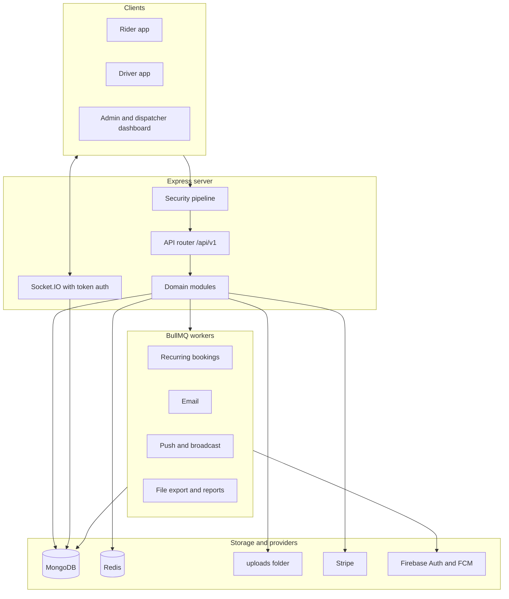
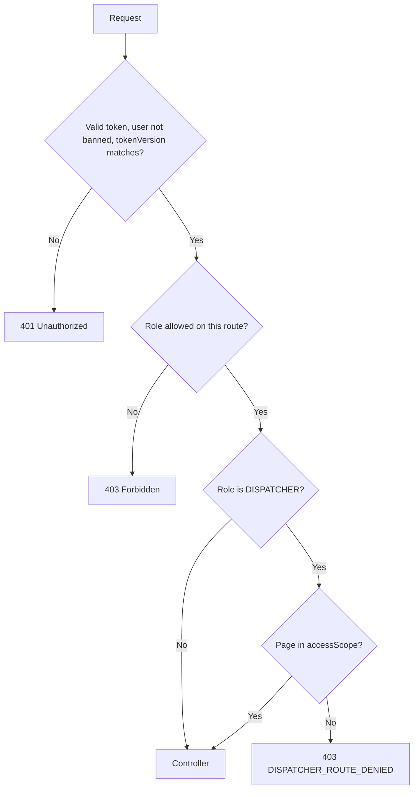
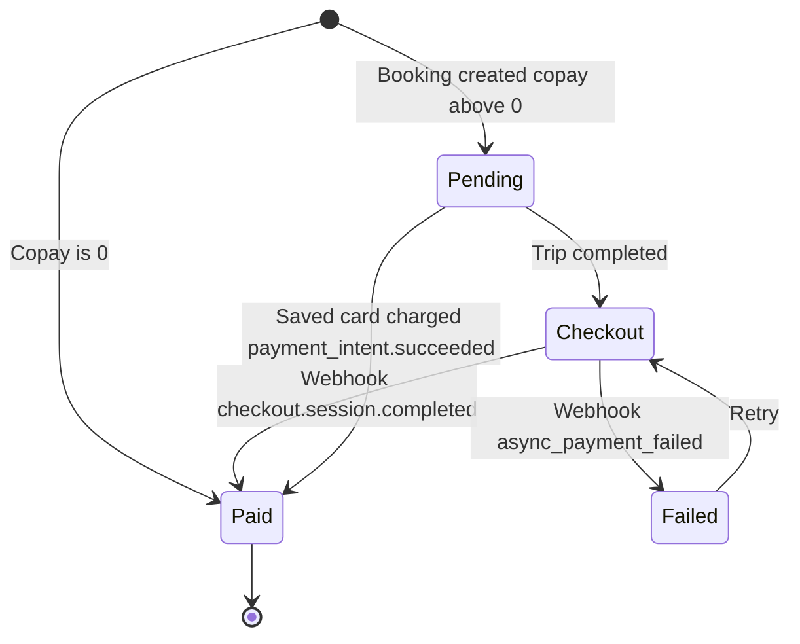
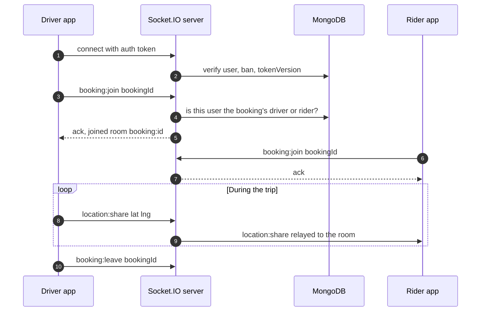
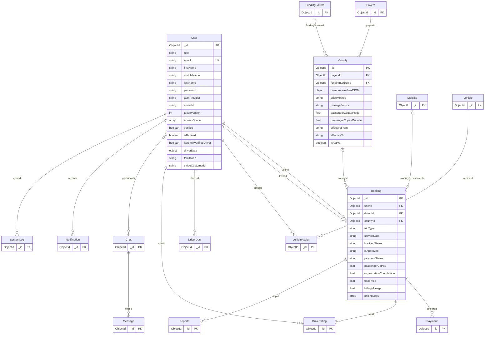

# Loggistick — NEMT Transportation Server

Backend for a **Non-Emergency Medical Transportation (NEMT)** platform: riders book medical trips, dispatchers plan and assign them, drivers run them, and funding sources (insurance, programs, counties) pay for them.

**Stack:** Node.js · Express 4 · TypeScript · MongoDB (Mongoose 8) · Redis · BullMQ · Socket.IO · Stripe · Firebase (Auth + Cloud Messaging) · Nodemailer

Clients: **Rider app** and **Driver app** (Flutter), **Admin / Dispatcher dashboard** (React).

---

## Contents

1. [Quick start](#1-quick-start)
2. [Architecture](#2-architecture)
3. [Project structure](#3-project-structure)
4. [Authentication & roles](#4-authentication--roles)
5. [Security](#5-security)
6. [Trip pricing](#6-trip-pricing)
7. [Payments (Stripe)](#7-payments-stripe)
8. [Background jobs (BullMQ)](#8-background-jobs-bullmq)
9. [Real-time (Socket.IO)](#9-real-time-socketio)
10. [Database](#10-database)
11. [API reference](#11-api-reference)
12. [Environment variables](#12-environment-variables)
13. [Testing](#13-testing)
14. [Deployment](#14-deployment)

---

## 1. Quick start

**Requirements:** Node.js 20+, MongoDB 6+, Redis 7+.

```bash
npm install                 # use npm, not yarn (package-lock.json + "overrides")
cp .env.example .env        # then fill in the values (see section 12)
npm run dev                 # ts-node-dev with auto-reload
```

- API: `http://localhost:<PORT>/api/v1`
- Health page: `http://localhost:<PORT>/`
- On first start a `SUPER_ADMIN` is created from `ADMIN_EMAIL` / `ADMIN_PASSWORD` if none exists.

| Script | What it does |
| :--- | :--- |
| `npm run dev` | Development server with auto-reload |
| `npm run build` | Compile TypeScript to `dist/` |
| `npm start` | Run the compiled server (`dist/server.js`) |
| `npm test` | Run all Jest tests |
| `npm run create-module` | Scaffold a new module (`src/gen/gm.ts`) |
| `npm run bench` / `bench:booking` | Load-test scripts in `bench/` |
| `npm run redis:clear` | Flush the Redis container (`loggistick-redis`) |

> ⚠️ Use **npm** for this repo. The `qs` security fix is an npm `overrides` entry that yarn ignores, and `yarn.lock` is not committed.

---

## 2. Architecture

Clients never talk to MongoDB, Redis, Stripe or Firebase directly. Every request goes through the Express pipeline (security → auth → role/scope check → module). Slow work (emails, push, recurring bookings, exports) is handed to BullMQ workers.



**Core domains**

| Domain | What it covers |
| :--- | :--- |
| Booking & scheduling | One-way, round-trip and recurring trips, approval, driver assignment, no-show and cancellation |
| Coverage & tariffs | County geofences (GeoJSON), funding-source rate cards, zone pricing, passenger copay |
| Fleet | Vehicles, vehicle-to-driver assignment, driver on/off duty |
| Payments | Stripe Checkout for copay, saved cards, webhook settlement |
| Communication | Chat, in-app notifications, FCM push, broadcasts, email |
| Admin | Dispatcher accounts with per-page access, system audit logs, reports, CMS (FAQ, rules) |

---

## 3. Project structure

```text
src/
├── app.ts                  # Express app: security pipeline, routes, error handler
├── server.ts               # Boot: Redis, MongoDB, seed admin, HTTP + Socket.IO, workers
├── app/
│   ├── builder/            # QueryBuilder (safe filter / search / sort / paginate)
│   ├── middlewares/        # auth, checkDispatcherRoute, validateRequest,
│   │                       # sanitizeMongo, sanitizeInput, fileUploaderHandlar
│   ├── modules/<name>/     # one folder per domain (see below)
│   └── routes/index.ts     # mounts every module under /api/v1
├── config/                 # env config, Redis, BullMQ, Stripe
├── helpers/                # JWT, sockets, Stripe copay, file security, notifications
├── queue/  worker/         # BullMQ queues and their workers
├── shared/  util/          # logger, response helpers, parsers
└── firebase.ts             # Firebase Admin (Auth + Messaging)
tests/security/             # security regression tests
```

Each module follows the same pattern:

| File | Role |
| :--- | :--- |
| `*.interface.ts` | TypeScript types |
| `*.model.ts` | Mongoose schema and indexes |
| `*.validation.ts` | Zod schemas (used by `validateRequest`) |
| `*.route.ts` | Router: `auth(...)` → `checkDispatcherRoute(...)` → upload → validation → controller |
| `*.controller.ts` | HTTP handler (`catchAsync` + `sendResponse`) |
| `*.service.ts` | Business logic and database access |

---

## 4. Authentication & roles

### Roles

| Role | Who |
| :--- | :--- |
| `SUPER_ADMIN` | Full access |
| `DISPATCHER` | Dashboard staff; access limited per page by `accessScope` |
| `DRIVER` | Driver app; must be approved by an admin (`isAdminVerifiedDriver`) before login |
| `USER` | Rider app |

### Tokens

- **Access token** (JWT, HS256, with issuer + audience) — send as `Authorization: Bearer <token>`.
- **Refresh token** — `POST /auth/refresh-token` with `{ token }` or the `refresh_token` cookie.
- Login also sets HttpOnly cookies `access_token`, `refresh_token` and a readable `csrf_token`.
- Every request re-checks the user in MongoDB: banned users, changed roles and old sessions are rejected.
- **Session revocation:** each user has a `tokenVersion`. Changing or resetting the password increments it, which logs out **all** existing sessions (REST, refresh and sockets).

### Login methods

| Method | Endpoint | Notes |
| :--- | :--- | :--- |
| Email + password | `POST /auth/login` | `{ email, password, fcmToken }` — `fcmToken` required for all roles except `SUPER_ADMIN` |
| Social (Google / Apple / Facebook) | `POST /auth/social-login` | `{ token, fcmToken, role?, social_type?, name?, picture? }` — `token` is a **Firebase ID token**, verified server-side with `verifyIdToken` |

Social login creates the account on the first login (`role` = `USER` or `DRIVER`, default `USER`) and only logs in afterwards. An existing email/password account with the same verified email is linked, not duplicated. Admin and dispatcher accounts can't use social login.

### Dispatcher page access

A dispatcher has `accessScope: string[]` — the dashboard pages they may use. Routes guarded with `checkDispatcherRoute("<page>")` return `403 DISPATCHER_ROUTE_DENIED` when the page is missing. Scopes are cached in memory per process.

Available pages: `/dashboard`, `/operations`, `/bookings`, `/live`, `/drivers`, `/riders`, `/applications`, `/reports`, `/trips`, `/schedule`, `/coverage`, `/fleet`, `/fleet/:id`, `/notifications`, `/settings`, `/profile`, `/finance`, `/transactions`, `/staff`, `/cms`, `/support`, `/push`.

Rules for managing dispatchers (`/staff` page):
- A dispatcher can only grant pages they have themselves.
- A dispatcher can't change their own scope.
- A dispatcher's `middleName` is shown as their role label in system logs, so dispatchers can't edit it themselves.



---

## 5. Security

Request pipeline in `src/app.ts`, in order:

| Layer | What it does |
| :--- | :--- |
| `helmet` | Security headers |
| CORS | `CORS_ORIGINS` set → only those origins, with cookies. Not set → any origin, **without** cookies (Bearer tokens and mobile apps are unaffected) |
| Body parsers | `express.json()` — 100 KB body limit |
| `sanitizeMongo` | Removes keys starting with `$` and `__proto__` / `constructor` / `prototype` at any depth (blocks NoSQL operator injection such as `{"$ne": …}` or `{"$set": …}`) |
| `sanitizeInput` | Removes `<script>`, `<iframe>`, `<svg>`, event handlers (`onerror=`) and `javascript:` links from text input; keeps safe formatting for CMS rich text; never touches passwords or tokens |
| Rate limits | All `/api/v1`: 200 req / 15 min · `/auth/*`: 10 / 15 min · broadcasts: 20 / 15 min |
| `auth(...)` | Token, ban, role and `tokenVersion` checks (+ CSRF check for cookie-authenticated `POST`/`PATCH`/`PUT`/`DELETE`: header `X-CSRF-Token` must equal the `csrf_token` cookie) |
| `checkDispatcherRoute(...)` | Dispatcher page access |

Data rules enforced in services:
- **Mass assignment:** signup, profile update and admin driver creation only accept whitelisted fields. Signup only allows `USER` / `DRIVER`.
- **Ownership:** riders and drivers can only update their own bookings, read/send messages in their own chats, and edit their own ratings.
- **Query strings:** `QueryBuilder` only accepts plain values as filters, escapes `searchTerm`, and blocks `password` / `tokenVersion` in filter, sort and `fields`.

### File uploads

Uploads are stored in `uploads/<folder>/` with a random file name and served at `/<folder>/<file>`.

| Field | Folder | Allowed extensions | Max size |
| :--- | :--- | :--- | :--- |
| `image`, `driverData.licenseImage`, `driverData[licenseImage]` | `image` | `.jpg` `.jpeg` `.png` | 20 MB |
| `doc` | `docs` | `.pdf` `.doc` `.txt` `.json` `.geojson` `.kml` `.zip` | 50 MB |
| `file` | `files` | `.txt` `.json` `.geojson` `.kml` `.zip` | 50 MB |
| `media` | `media` | `.mp4` `.mp3` | 500 MB |

The public signup route only accepts the image fields (20 MB). Uploads always run **after** authentication.

**Malware check** (`src/helpers/fileSecurity.ts`) — every uploaded file is inspected before the route uses it. If any file is unsafe, **all files of that request are deleted**, the request gets `400 File rejected — <reason>`, and the attempt is logged with IP and user.

1. Real content must match the extension (magic bytes) — a renamed `.exe` is not a `.png`.
2. No executables (Windows, Linux, macOS, Java) or `#!` scripts.
3. No embedded code: `<?php`, `<script>`, `<iframe>`, `javascript:`, `onerror=` … (blocks polyglot images and stored XSS).
4. PDF: no JavaScript, launch actions, embedded files or rich media.
5. Word `.doc`: no VBA macros.
6. ZIP: no executables / scripts / HTML inside and no `../` paths.
7. **Optional ClamAV** virus scan when `CLAMAV_HOST` is set. If it is set but unreachable, uploads are rejected (fail closed).

> Built-in checks catch disguised and script-carrying files. Recognising actual virus signatures (for example inside compressed PDF streams or ZIP entries) needs ClamAV — enable it in production.

---

## 6. Trip pricing

Code: `src/app/modules/booking/pricing/tripPricing.ts` and `booking.utils.ts`. The price is always calculated **on the server**; fare fields sent by a client are ignored.

### Step 1 — Distance

Straight-line distance uses the Haversine formula with the Earth radius in miles:

```math
a = \sin^2\left(\frac{\Delta\varphi}{2}\right) + \cos\varphi_1 \cos\varphi_2 \sin^2\left(\frac{\Delta\lambda}{2}\right)
```

```math
d = 2R \cdot \operatorname{atan2}\left(\sqrt{a},\ \sqrt{1-a}\right), \qquad R = 3958.8 \text{ miles}
```

where φ is latitude and λ is longitude, both in radians, and R is the Earth radius.

The county's `mileageSource` decides which distance is billed:

| `mileageSource` | Billed miles |
| :--- | :--- |
| `calculated_route` | Driving distance from the routing service |
| `actual_gps` | Distance recorded during the trip |
| `straight_line` | Haversine distance |

If the chosen value is missing, the straight-line distance is used (`straight_line_fallback`). The miles are then rounded with `mileageRounding` (`none`, `nearest`, `up`, `down`) to `mileagePrecision` decimal places.

### Step 2 — Zone

```math
\text{zone} = \begin{cases} \text{inside} & \text{if pickup and drop-off are both inside the county} \\ \text{outside} & \text{otherwise} \end{cases}
```

Each zone has its own rate card and passenger copay. A county is only used when the service date is between `effectiveFrom` and `effectiveTo`.

### Step 3 — Funding-source charge

Symbols used below:

| Symbol | Field |
| :--- | :--- |
| *m* | billed miles (after rounding) |
| *F* | `flat_rate_price` |
| *B* | `base_rate` |
| *r* | `per_mile_rate` |
| *I* | `initial_charge` |
| *n* | `initial_miles` |
| *p* | `additional_per_mile` |

**`flat_rate`**

```math
C = F
```

**`per_mile`**

```math
C = B + m \cdot r
```

**`first_x_miles`** — the first *n* miles are included in *I*:

```math
C = I + \max(0,\ m - n) \cdot p
```

**`mileage_based`** — fixed charge from the matching bracket in `mileage_brackets`:

```math
C = \text{charge of the bracket where } \text{min} \le m \le \text{max}
```

Brackets must start at the given minimum, must not overlap or leave gaps, and only the last one may be open-ended (no `max_mileage`). An exact `max_mileage` belongs to that bracket. All money values are rounded to 2 decimals.

A round trip is priced as two legs (`outbound`, `return`); each leg gets its own zone and charge. The legs are stored in `pricingLegs`.

### Step 4 — Split and totals

```math
\text{organizationContribution} = C
```

```math
\text{totalPrice} = \text{organizationContribution} + \text{passengerCoPay}
```

The passenger copay comes from the zone (`passengerCopayInside` / `passengerCopayOutside`) and is **not** subtracted from the funding-source charge. When the copay is `0`, the booking is created with `paymentStatus: "paid"`.

For cancellations and no-shows, the county's `cancellationNoShow` rules pick an outcome:

| Outcome | Funding source pays | Passenger pays |
| :--- | :--- | :--- |
| `none` | 0 | 0 |
| `passenger_only` | 0 | copay |
| `funding_source_only` | charge | 0 |
| `both` | charge | copay |

Riders never see `organizationContribution` or `totalPrice` — only their copay.

---

## 7. Payments (Stripe)

Only the **passenger copay** is charged through Stripe; the funding-source share is billed outside the app.



- The first copay goes through **Stripe Checkout**. The card is saved on a Stripe Customer (`stripeCustomerId`, `stripeDefaultPaymentMethodId`) and later trips can charge it directly.
- Webhook: `POST /api/stripe/webhook` (outside `/api/v1`, raw body). The `stripe-signature` header is verified with `STRIPE_WEBHOOK_SECRET`. Handled events: `checkout.session.completed`, `payment_intent.succeeded`, `checkout.session.async_payment_failed`.
- A settled copay upserts one `Payment` per booking.

---

## 8. Background jobs (BullMQ)

Queues live in Redis (`BULLMQIP` / `BULLMQPORT`). Workers are started by `server.ts` in the same process.

| Queue | Worker | Job |
| :--- | :--- | :--- |
| `booking` | `booking.worker.ts` | Create the bookings of a recurring series |
| `send-email` | `email.worker.ts` | OTP, account and notice emails |
| `broadcast-notification` | `notification.worker.ts` | Admin broadcasts to a role / everyone |
| push queue | `pushNotification.worker.ts` | FCM push; removes dead device tokens |
| `file-export` | `export.worker.ts` | Excel / CSV exports |
| `report-assigned` | `report.worker.ts` | Report assignment follow-up |
| driver duty queue | `driverduty.worker.ts` | Driver on/off-duty sessions |

---

## 9. Real-time (Socket.IO)

**A valid access token is required** — connections without one are refused.

```js
// JavaScript
io(BASE_URL, { auth: { token: accessToken } });
```

```dart
// Flutter (socket_io_client)
IO.io(baseUrl, IO.OptionBuilder()
    .setTransports(['websocket'])
    .setAuth({'token': accessToken})
    .build());
```

The token can also be sent as an `Authorization: Bearer` header or `?token=`. The server applies the same checks as REST (ban, role, `tokenVersion`). After a token refresh, reconnect with the new token. Each socket joins the private room `user:<userId>`.

| Event | Direction | Payload | Notes |
| :--- | :--- | :--- | :--- |
| `booking:join` | client → server | `{ bookingId }` | The user comes from the token. Only the booking's rider or driver can join; closed trips are refused. Joins room `booking:<id>` |
| `booking:leave` | client → server | `{ bookingId }` | Leaves the room |
| `location:share` | driver → server | `{ bookingId, lat, lng, heading?, speed? }` | Must have joined first; `lat` in −90…90, `lng` in −180…180 |
| `location:share` | server → room | `{ bookingId, fromUserId, role, location: { lat, lng, heading, speed, updatedAt } }` | Sent to the other members of the booking room |
| `getMessage::<chatId>` | server → client | Message document | Sent only to the chat's participants |
| `get-notification::<userId>` | server → client | Notification document | New in-app notification |

All join/leave/share events reply through an acknowledgement: `{ success, message?, data? }`.



---

## 10. Database

MongoDB is the system of record; each module owns one collection. Lines are Mongoose `ObjectId` references, labelled with the field that holds them. The diagram shows key fields only.



Other collections without relationships: `Faq`, `Rule`, `Facility`, `CompanySupport`, `PushNotification`, `BroadcastNotification`, `EmergencyContact`, `Bankcard`, `ResetToken`.

| Concern | Choice |
| :--- | :--- |
| Coordinates | Booking points are `[lng, lat]` arrays. County areas are GeoJSON `Polygon` / `MultiPolygon` |
| Auth lookups | `users.email` unique; `role` indexed; passwords are bcrypt hashes with `select: false`; social accounts have no password |
| Bookings | Indexed by `userId`, `driverId`, `serviceDate`, `bookingStatus`, `recurringBatchId` and schedule compounds |
| Audit trail | `systemlogs` stores who changed what (`CREATE` / `UPDATE` / `DELETE` with before/after values) for admin and dispatcher actions |
| Redis | OTPs (3 min), cached lookup lists, BullMQ jobs |
| Files | Local disk under `uploads/` |

---

## 11. API reference

### Conventions

- **Base URL:** `/api/v1` (Stripe webhook: `/api/stripe/webhook`)
- **Auth:** `Authorization: Bearer <accessToken>`
- **Uploads:** `multipart/form-data`; other fields may be sent as one JSON string in a `data` field.
- **List queries:** `page`, `limit`, `sort` (e.g. `-createdAt`), `searchTerm`, `fields`, plus plain `field=value` filters (repeat a key for "any of").

Success response:

```json
{ "success": true, "message": "…", "data": {}, "pagination": { "page": 1, "limit": 10, "total": 0, "totalPage": 0 } }
```

Error response:

```json
{ "success": false, "message": "…", "errorMessages": [{ "path": "…", "message": "…" }] }
```

The HTTP status code is the response status. `pagination` is only present on list endpoints. Outside production, errors also include `stack`.

In the tables: **Roles** `SA` = `SUPER_ADMIN`, `DP` = `DISPATCHER`, `DR` = `DRIVER`, `US` = `USER`. **Scope** = dispatcher page required (section 4). 📎 = accepts file upload.

### Auth — `/auth`

All `/auth` routes have the strict auth rate limit.

| Method | Path | Roles | Scope | Description |
| :--- | :--- | :--- | :--- | :--- |
| POST | `/auth/login` | Public | | `{ email, password, fcmToken }` → `{ role, accessToken, refreshToken }` |
| POST | `/auth/social-login` | Public | | `{ token, fcmToken, role?, social_type? }` — Firebase ID token |
| POST | `/auth/refresh-token` | Public | | `{ token }` or cookie → new token pair |
| POST | `/auth/forgot-password` | Public | | `{ email }` → emails a 6-digit OTP |
| POST | `/auth/resend-otp` | Public | | `{ email }` |
| POST | `/auth/verify-email` | Public | | `{ email, oneTimeCode }` → verifies account, or returns a reset token |
| POST | `/auth/reset-password` | Reset token | | Header `Authorization: <resetToken>`, `{ newPassword, confirmPassword }` — logs out all sessions |
| POST | `/auth/change-password` | SA DP DR US | `/profile` | `{ currentPassword, newPassword, confirmPassword }` — logs out all sessions |
| GET | `/auth/user/:id` | SA DP | `/riders` | User details with trip totals |
| DELETE | `/auth/delete-account` | SA | | Delete account |

### Users — `/user`, `/user-management`

| Method | Path | Roles | Scope | Description |
| :--- | :--- | :--- | :--- | :--- |
| POST | `/user` 📎 | Public | | Sign up as `USER` or `DRIVER` (images only) |
| GET | `/user/profile` | SA DP DR US | `/profile` | Own profile |
| PATCH | `/user` 📎 | SA DP DR US | `/profile` | Update own profile (name, contact, location, photo, push setting) |
| PATCH | `/user/banned/:id` | SA DP | | Ban / unban a user or driver |
| POST | `/user/dispatcher` | SA DP | `/staff` | Create dispatcher `{ …, accessScope }` |
| GET | `/user/dispatcher` | SA DP | `/staff` | List dispatchers |
| PATCH | `/user/dispatcher/:id/routes` | SA DP | `/staff` | `{ accessScope }` |
| POST | `/user/driver` 📎 | SA DP | `/drivers` | Create an approved driver |
| GET | `/user/drivers` | SA DP US | `/drivers` | Driver list (riders get public fields only) |
| GET | `/user/riders` | SA DP | `/riders` | Rider list |
| GET | `/user/driver-applications` | SA DP | `/applications` | Pending driver applications |
| PATCH | `/user/driver-application` 📎 | DR | | Driver updates own application |
| POST | `/user-management` | SA DP | `/riders` | Create rider with generated password (emailed) |

### Bookings — `/booking`, `/bookings`, `/my-ongoing-bookings`

| Method | Path | Roles | Scope | Description |
| :--- | :--- | :--- | :--- | :--- |
| POST | `/booking/calculate-price` | SA DP US | | Price quote (section 6) |
| POST | `/booking` | SA DP US | | Create booking; recurring: `recurringBooking: true, selectedDate: ["monday", …], endDate` |
| GET | `/booking` | SA DP DR | | Pending bookings |
| GET | `/booking/approved` | SA DP | `/bookings` | Approved, ready to assign |
| GET | `/booking/my` | SA DP DR US | `/bookings` | Caller's bookings |
| GET | `/booking/scheduled` | SA DP DR | `/schedule` | Scheduled trips |
| GET | `/booking/history` | SA DP DR US | `/trips` | Trip history |
| GET | `/booking/history/export-fields` | SA DP DR US | `/trips` | Columns available for export |
| GET / POST | `/booking/history/export` | SA DP DR US | `/trips` | Export history (`/history/excel` is the old path) |
| GET | `/booking/:id` | SA DP DR US | `/bookings` | Booking details |
| PATCH | `/booking/:id` | SA DP DR US | `/bookings` | Update status / details. Riders and drivers: own booking only; fare fields are server-set |
| GET | `/booking/rider/:id` | SA | | A rider's bookings |
| GET | `/bookings/schedule` | SA DP | | Today's trips |
| GET | `/bookings/schedule/onboarding` | SA DP | | Today's counts by status |
| GET | `/my-ongoing-bookings` | SA DR US | | Ongoing bookings (mobile) |
| GET | `/my-ongoing-bookings/upcoming` | SA DR US | | Upcoming |
| GET | `/my-ongoing-bookings/recent-activity` | SA DR US | | Recent activity |
| GET | `/my-ongoing-bookings/:id` | SA DR US | | Booking details (mobile) |
| GET | `/my-ongoing-bookings/current` | DR | | Driver's current trip |
| GET | `/my-ongoing-bookings/next-trip` | DR | | Driver's next trip |
| GET | `/my-ongoing-bookings/all-trips` | DR | | Driver's trips |
| GET | `/my-ongoing-bookings/driver-overview-data` | SA DR | | Driver KPIs (`/overview-data` is an alias) |
| GET | `/my-ongoing-bookings/today` | US | | Rider's trip today |
| GET | `/my-ongoing-bookings/user/profile` | US | | Rider trip totals |

### Coverage & tariffs — `/counties`, `/mobility`, `/payers`, `/funding-sources`

| Method | Path | Roles | Scope | Description |
| :--- | :--- | :--- | :--- | :--- |
| GET | `/counties` | Public | | Active counties |
| GET | `/counties/check-location` | SA DP DR US | `/coverage` | `?lat=&lng=` — is the point covered? |
| GET | `/counties/:id` | SA DP DR US | `/coverage` | County details |
| GET | `/counties/admin/:id` | SA DP | `/coverage` | Admin view |
| POST | `/counties` 📎 | SA DP | `/coverage` | Create county (geofence as GeoJSON in `file` / `doc`) |
| PATCH | `/counties/:id` 📎 | SA DP | `/coverage` | Update county / rates |
| DELETE | `/counties/:id` | SA DP | `/coverage` | Delete county |
| GET | `/mobility`, `/mobility/:id` | SA DP DR US | `/settings` | Mobility types (wheelchair, stretcher …) |
| POST | `/mobility` 📎 | SA DP | `/settings` | Create (`image` → icon) |
| PATCH / DELETE | `/mobility/:id` | SA DP | `/settings` | Update / delete |
| GET | `/payers` | SA DP DR US | | Active payers |
| GET | `/payers/admin` | SA DP | `/finance` | All payers |
| GET | `/payers/:id` | SA DP DR US | `/finance` | Payer details |
| POST | `/payers` | SA DP | `/finance` | Create payer |
| PATCH / DELETE | `/payers/:id` | SA DP | `/finance` | Update / delete |
| GET | `/funding-sources`, `/funding-sources/:id` | SA DP DR US | `/finance` | Funding sources |
| POST | `/funding-sources` | SA | | Create |
| PATCH / DELETE | `/funding-sources/:id` | SA | | Update / delete |

### Fleet & drivers — `/vehicle`, `/vehicle-assign`, `/driver-duty`, `/applications`

| Method | Path | Roles | Scope | Description |
| :--- | :--- | :--- | :--- | :--- |
| GET | `/vehicle` | SA DP DR US | | Vehicles |
| GET | `/vehicle/:id` | SA DP DR US | `/fleet/:id` | Vehicle details |
| POST | `/vehicle` | SA | | Create vehicle |
| PATCH / DELETE | `/vehicle/:id` | SA | | Update / delete |
| GET | `/vehicle-assign`, `/vehicle-assign/:id` | SA DP | `/operations` | Assignments |
| POST | `/vehicle-assign` | SA | | `{ driverId, vehicleId }` |
| PATCH / DELETE | `/vehicle-assign/:id` | SA | | Update / delete |
| POST | `/driver-duty` | DR | | Toggle on / off duty |
| GET | `/driver-duty` | DR | | Current duty status |
| GET | `/driver-duty/history` | DR | | Own duty history |
| GET | `/driver-duty/active` | SA DP | | Drivers on duty now |
| GET | `/driver-duty/logs` | SA DP | `/drivers` | All duty logs |
| GET | `/applications/drivers` | SA DP | `/drivers` | Driver applications |
| PATCH | `/applications/:id` | SA | | Approve / reject a driver |

### Payments — `/payment`, `/bankcard`

| Method | Path | Roles | Scope | Description |
| :--- | :--- | :--- | :--- | :--- |
| GET | `/payment` | SA | | Payments |
| GET | `/payment/overview` | SA | | Revenue overview |
| GET | `/payment/export` | SA | | Excel export |
| POST / GET | `/bankcard` | SA US | | Save / get card details |
| POST | `/api/stripe/webhook` | Stripe | | Signature-verified webhook (section 7) |

### Communication — `/chat`, `/message`, `/notification`, `/notifications`, `/push-notification`

| Method | Path | Roles | Scope | Description |
| :--- | :--- | :--- | :--- | :--- |
| POST | `/chat/:id` | SA DR US | | Open / create chat with user `:id` |
| GET | `/chat` | US | | Own chats (`?search=`) |
| POST | `/message` 📎 | SA DP DR US | `/support` | `{ chatId, text, receiver? }` + optional `image`; participants only |
| GET | `/message/:chatId` | SA DP DR US | `/support` | Chat history; participants only (staff: any chat) |
| GET | `/notification` | SA DP DR US | `/notifications` | Own notifications |
| GET | `/notification/count-unread` | SA DP DR US | | Unread count |
| POST | `/notification` | SA DP DR US | `/notifications` | Create notification |
| PATCH | `/notification/read-all` | SA DP DR US | `/notifications` | Mark all read |
| PATCH | `/notification/:id` | SA DP DR US | `/notifications` | Mark one read |
| POST | `/notifications/send` | SA | | Broadcast `{ title, description, audience }` (queued) |
| GET | `/notifications` | SA | | Broadcast history |
| POST / GET | `/push-notification` | SA | | Send / list FCM push by role |

### Admin, reports & content

| Method | Path | Roles | Scope | Description |
| :--- | :--- | :--- | :--- | :--- |
| GET | `/dashboard/statistics` | SA DP | | Overview numbers |
| GET | `/dashboard/admin/dashboard-overview` | SA DP | | Dashboard overview |
| GET | `/dashboard/active-trips` | SA DP | | Active trips |
| GET | `/dashboard/pending-trips` | SA DP | | Pending trips |
| GET | `/dashboard/pending-bookings` | SA DP | | Latest 5 pending bookings |
| GET | `/dashboard/admin/trip-distribution` | SA DP | | Trip distribution |
| GET | `/dashboard/rider/trip-history/:id` | SA DP | `/riders` | A rider's trip history |
| GET | `/system-logs` | SA DP | | Audit log. Filters: `module`, `action`, `entityId`, `actorRole` (`SUPER_ADMIN` or a dispatcher middle name) |
| GET | `/system-logs/actor-roles` | SA DP | | Options for the `actorRole` filter |
| POST | `/reports` | SA DP DR US | `/reports` | File a trip report |
| GET | `/reports/my` | SA DP DR US | `/reports` | Own reports |
| GET | `/reports`, `/reports/:id` | SA DP | `/reports` | All reports / details |
| PATCH | `/reports/:id` | SA DP | `/reports` | Update report |
| DELETE | `/reports/:id` | SA | | Delete report |
| POST | `/ratings` | SA US | | `{ tripId, rating, comment }` — own completed trip; driver taken from the trip |
| GET | `/ratings`, `/ratings/:id` | SA US | | Ratings |
| PATCH | `/ratings/:id` | SA US | | Edit own rating (`rating`, `comment`) |
| POST / GET | `/emergency-contact` | SA DR US | | Save / get own emergency contact |
| GET | `/contuct-dispatcher` | SA DP DR US | | Support contact numbers |
| POST | `/company-support` | SA | | Save support contact info |
| GET | `/company-support` | SA DP DR US | `/support` | Support contact info |
| GET | `/facilities-and-programs`, `…/:id` | SA DP DR US | `/cms` | Facilities and programs |
| POST | `/facilities-and-programs` | SA | | Create |
| PATCH / DELETE | `/facilities-and-programs/:id` | SA | | Update / delete |
| GET | `/faq` | Public | | FAQs (`?role=`) |
| POST | `/faq` | SA | | Create FAQ |
| PATCH / DELETE | `/faq/:id` | SA | | Update / delete |
| GET | `/rule/:type` | Public | | Legal / CMS page (e.g. `privacy`, `terms`, `about`) |
| POST | `/rule` | SA | | Create / update a page (rich text) |

---

## 12. Environment variables

Copy `.env.example` to `.env`. Never commit `.env`.

| Variable | Required | Description |
| :--- | :--- | :--- |
| `NODE_ENV` | yes | `development` / `production` / `test` |
| `IP`, `PORT` | yes | Bind address and port (e.g. `0.0.0.0`, `5000`) |
| `LOG_LEVEL` | | Winston level |
| `DATABASE_URL` | yes | MongoDB connection string |
| `BCRYPT_SALT_ROUNDS` | yes | e.g. `12` |
| `JWT_SECRET`, `JWT_REFRESH_SECRET` | yes | Long random secrets (32+ chars) |
| `JWT_ACCESS_EXPIRES_IN`, `JWT_REFRESH_EXPIRES_IN` | yes | e.g. `1d`, `30d` |
| `JWT_ISSUER`, `JWT_AUDIENCE` | yes | Checked on every token |
| `COOKIE_SECURE` | | `true` in production (HTTPS) |
| `COOKIE_SAME_SITE` | | `lax` / `strict` / `none` |
| `CORS_ORIGINS` | | Comma-separated browser origins allowed to use cookies (e.g. the dashboard URL) |
| `ADMIN_EMAIL`, `ADMIN_PASSWORD` | yes | First `SUPER_ADMIN` |
| `EMAIL_FROM`, `EMAIL_USER`, `EMAIL_PASS`, `EMAIL_HOST`, `EMAIL_PORT` | yes | SMTP |
| `APP_DOWNLOAD_URL` | | Link used in emails |
| `STRIPE_SECRET_KEY`, `STRIPE_WEBHOOK_SECRET` | yes | Stripe |
| `PAYMENT_SUCCESS_URL`, `PAYMENT_CANCEL_URL` | yes | Stripe Checkout redirects |
| `REDIS_HOST`, `REDIS_PORT` | yes | Redis (cache, OTP) |
| `BULLMQIP`, `BULLMQPORT` | yes | Redis for BullMQ (usually the same) |
| `FIREBASE_PROJECT_ID`, `FIREBASE_CLIENT_EMAIL`, `FIREBASE_PRIVATE_KEY` | yes | Firebase Admin service account — push **and** social login. Must be the same Firebase project the apps sign in with |
| `GOOGLE_MAPS_API_KEY` | yes | Route distance |
| `TWILIO_ACCOUNT_SID`, `TWILIO_AUTH_TOKEN`, `TWILIO_NUMBER` | | SMS |
| `CLAMAV_HOST`, `CLAMAV_PORT` | | Enable ClamAV upload scanning (default port `3310`) |

`tokenVersion`, `GOOGLE_CLIENT_*` and `FACEBOOK_CLIENT_*` in `.env.example` are no longer used (sessions use the per-user `tokenVersion`; social login uses Firebase).

---

## 13. Testing

```bash
npx jest tests/security --forceExit
```

The security suite (`tests/security/`, 94 tests) covers signup and profile mass assignment, dispatcher scope escalation, NoSQL injection, booking / chat / rating ownership, socket authentication, CSRF, session revocation, upload extension rules, malware detection (including a fake ClamAV server and the EICAR test file) and script removal from text input. The tests mock MongoDB, Redis and Firebase, so no services are needed.

Type check: `npx tsc --noEmit`.

---

## 14. Deployment

### Docker Compose

`docker-compose.yml` runs the **app** and **Redis**. MongoDB is **not** included — point `DATABASE_URL` at your MongoDB server.

```bash
docker compose up -d --build
docker compose ps
docker compose logs -f app
```

- The image (`node:20-alpine`) exposes and health-checks port **9999**, so set `PORT=9999` in `.env` when using Docker.
- The compose file publishes no app port; put a reverse proxy (e.g. Nginx with TLS) in front, or add a `ports` mapping.
- Inside a container `127.0.0.1` is the container itself: use `REDIS_HOST=redis` (already set by compose) and a reachable host for MongoDB.
- Mount `uploads/` as a volume if uploaded files must survive container rebuilds.

### Without Docker

```bash
npm ci
npm run build
NODE_ENV=production npm start
```

### Production checklist

- [ ] `NODE_ENV=production`, `COOKIE_SECURE=true`, HTTPS in front of the server
- [ ] Strong `JWT_SECRET` / `JWT_REFRESH_SECRET` and a changed `ADMIN_PASSWORD`
- [ ] `CORS_ORIGINS` set to the dashboard URL(s)
- [ ] Stripe webhook endpoint registered with `STRIPE_WEBHOOK_SECRET`
- [ ] Firebase service account from the same project as the mobile apps
- [ ] ClamAV running and `CLAMAV_HOST` set (raise ClamAV `StreamMaxLength` for large media)
- [ ] Mobile apps send the access token when connecting to Socket.IO
- [ ] Regular MongoDB and `uploads/` backups
